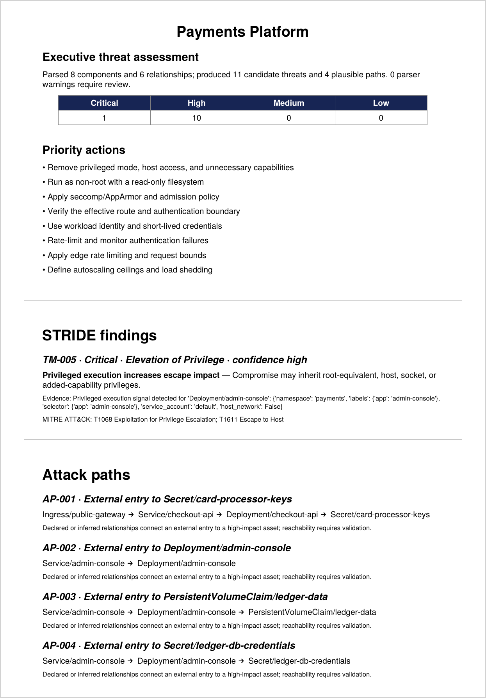

# AI Threat Modelling Engine

[](https://github.com/thenayanhazra/ai-threat-modelling-engine/actions/workflows/ci.yml)
[](LICENSE)

**Turns an architecture diagram or infrastructure code into a threat model that a board can read and an engineer can act on.**

Give it a Mermaid or draw.io diagram, Terraform, Kubernetes manifests or a Docker Compose file. It returns STRIDE findings tied to evidence in your own files, attack paths from the internet to your sensitive assets, MITRE ATT&CK mappings, and an executive PDF.

## Why it matters

- **Threat modelling usually lags delivery.** Workshops take weeks while the architecture changes daily. This produces a first-pass model in seconds, so expert time goes on judgment rather than inventory.
- **Every finding shows its evidence.** Each threat points to the resource and setting that triggered it, with a confidence level. The report also states what it could not see, so nothing is claimed without a source.
- **One analysis, two audiences.** The PDF opens with severity counts and priority actions for leadership. The JSON API feeds the same findings into engineering backlogs.

## What you get

A scan of [a sample payments platform](examples/payments-platform.yaml) with two deliberate weaknesses: a public admin console running as root, and payment secrets reachable from the internet.



[Full sample report (PDF)](docs/sample-report.pdf): 11 findings and 4 attack paths, generated in under a second.

---

## What works

- Mermaid flowcharts and draw.io XML diagrams
- Terraform resource discovery and risky-setting detection
- Kubernetes multi-document YAML and Docker Compose
- Deterministic findings tied to supplied evidence
- Graph-based paths from public entry points to data stores or privileged workloads
- JSON API and board-ready PDF output
- Optional OpenAI executive enrichment constrained to deterministic evidence and existing finding IDs
- Parser coverage, unsupported-construct warnings, assumptions, and confidence per finding
- Kubernetes Ingress/Service/workload, Secret, and persistent-volume relationship resolution
- Bounded uploads and graph traversal, structured error handling, and AI failure fallback

The engine does not claim that a MITRE technique occurred. Mappings describe plausible adversary behavior and must be validated against runtime evidence.

## Run

```bash
cp .env.example .env
docker compose up --build
```

Open `http://localhost:8000/docs`, or:

```bash
curl -F file=@examples/architecture.mmd \
  -F kind=mermaid \
  -F title="Payments Platform" \
  -F ai_enrichment=true \
  http://localhost:8000/v1/analyze

curl -o threat-model.pdf \
  -F file=@examples/architecture.mmd \
  -F kind=mermaid \
  http://localhost:8000/v1/report.pdf
```

For `.yaml`/`.yml`, pass `kind=kubernetes` or `kind=compose` because the extension is ambiguous.

## Development

```bash
python -m venv .venv
. .venv/bin/activate
pip install -e '.[dev]'
pytest
ruff check .
uvicorn app.main:app --reload
```

## Architecture

```mermaid
flowchart TD
  input[Diagram or IaC] --> parser[Safe format parser]
  parser --> graph[Normalized component graph]
  graph --> engine[STRIDE and path engine]
  engine --> model[Evidence-backed threat model]
  model --> json[JSON API]
  model --> pdf[Executive PDF]
```

## API and safety boundaries

Uploads are parsed in memory and capped at 5 MiB. XML uses `defusedxml`; YAML uses `safe_load_all`. The service does not execute Terraform, templates, containers, or uploaded code. Deploy behind authentication, TLS, malware scanning, tenant isolation, rate limits, and encrypted storage if inputs or reports are retained.

Terraform uses an HCL AST, but effective values from variables, provider defaults, modules, plans, and state remain evidence gaps. Kubernetes runtime reachability, cloud IAM, service meshes, and NetworkPolicy also require additional evidence. Reports label findings as candidates and expose coverage, assumptions, warnings, and confidence so absence of a finding is never presented as proof of safety.

## Roadmap

- OpenAI JSON-schema structured outputs and richer evidence-grounded narrative sections
- Terraform plan/state and module ingestion
- Kubernetes RBAC, NetworkPolicy, service-mesh, and cloud-IAM resolution
- Editable assumptions, compensating controls, risk acceptance, and reviewer workflow
- DFD visualization, multi-tenant persistence, SSO/RBAC, audit logs, and signed reports
- ATT&CK Enterprise version pinning and automated mapping validation

## License

Apache-2.0
